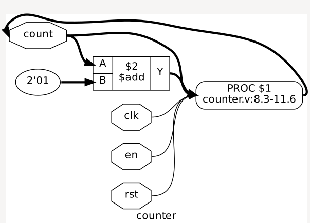
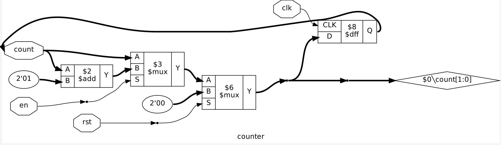
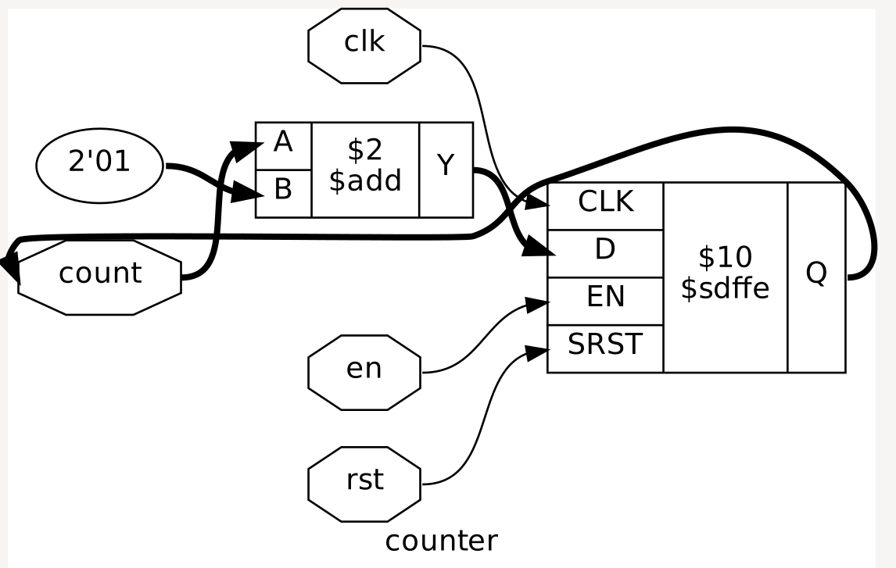
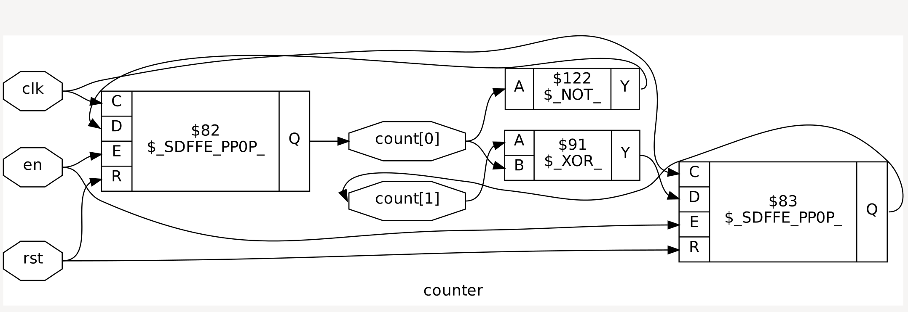
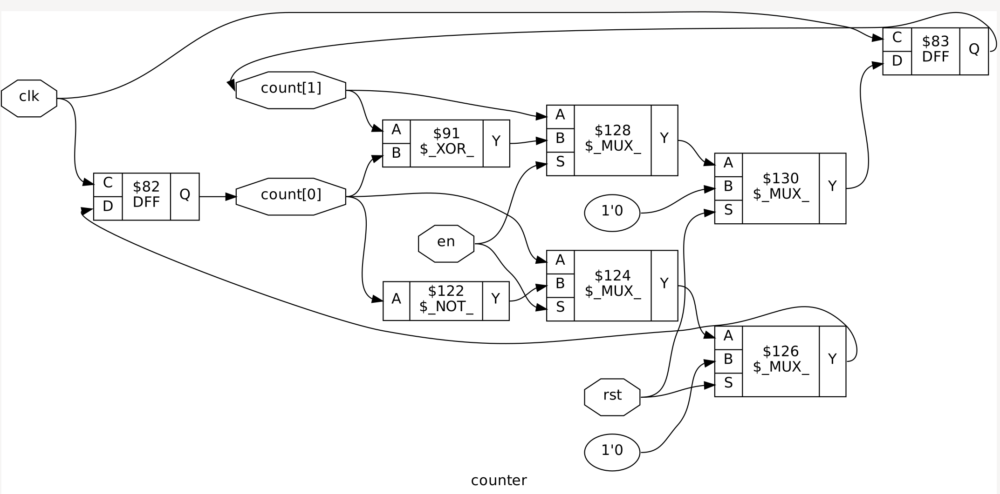

## D6-从RTL代码到可流片版图

### RTL仿真(Simulation) - 功能验证

**C语言电路仿真程序**

一个寄存器包含三个变量
```c
uint64_t light : 16
uint64_t light_next : 16
uint64_t light_update : 1 
```

模拟硬件寄存器在时钟边沿更新：
`EVAL(c, led, value)` 先把 value 写进 led_next，再标记 led_update。等组合逻辑都算完，UPDATE(c, led) 才把下一状态写入当前状态


### Verilog的仿真行为和编码风格

 [Verilog 标准手册](http://staff.ustc.edu.cn/~songch/download/IEEE.1364-2005.pdf#page=188&zoom=100,120,89)11章总结了其本质


#### 11.1 Verilog代码的执行

Verilog 是一门并行编程语言，其语义在一些场景下存在不确定性， 如

```verilog
always @(posedge clk) a = b;
always @(posedge clk) c = a;
```
等到上升沿， =（阻塞赋值）会立即更新左值；但两个 always 块谁先执行没有保证，所以 c 可能读到旧 a，也可能读到新 a，形成竞态。

```verilog
always @(posedge clk) a <= b;
always @(posedge clk) c <= a;
```
所以在时钟触发的寄存器逻辑中常用<=；触发时，先读取当时的 b 并安排更新；a 不会在这条语句执行的瞬间改变，而是在当前仿真时刻的后续非阻塞赋值更新阶段改变。c<=a 读取的是上升沿前的旧 a。

#### 11.2 基于事件的仿真

**更新事件和求值事件**

```verilog
always @(a)
  y = a;
```
- 更新事件： 当 a 的值发生变化时，产生一个关于 a 的更新事件
- 求值事件： 仿真器发现 always @(a) 对 a 敏感，于是安排它运行；运行过程是求值事件


过程执行 y = a，如果 y 的值确实改变，又会产生 y 的更新事件。


#### 11.3 层次化事件队列

**活动事件**

包括`always` 求值、阻塞赋值、连续赋值传播

**非活动事件**

```verilog 

reg trigger = 0;
reg result  = 0;

always @(trigger)
  result = trigger;

initial begin
  trigger = 1;
  #0;
  $display("result=%b", result);
end
```
- `#0`: 当前活动区域的事件先处理；之后当前过程才从 #0 后继续。
- 如果没有`#0`: initial 和 always  的执行顺序不确定， 导致打印的值也不确定；直接执行完initial， 会打印0；执行了always， 会打印1 
- 有`#0`:display 在活动区域执行完后再打印

**非阻塞赋值事件**

```verilog
always @(posedge clk)
  q <= d;
```
时钟上升沿到来时，过程先读取当时的 d，并把“稍后将 q 更新为这个值”安排到 NBA 区域。活动事件处理完后，仿真器才真正更新 q

**监控事件**

```verilog
always @(posedge clk) begin
  q <= d;
  $display("display q=%b", q);
  $strobe ("strobe  q=%b", q);
end
```
$display 在活动阶段执行，此时 NBA 还没更新 q，所以通常打印旧值。$strobe 在监控阶段执行，等本时刻的 NBA 更新完成后再打印，因此通常打印新值。


**未来事件**
```
initial begin
  a = 0;
  #5 a = 1;
end
```
执行到 #5：当前过程initial暂停，仿真器记录“时间到 5 个时间单位后，处理完时间0其他待办事件后，回复过程， 执行a=1;


#### 赋值操作的事件调度

- 连续赋值 assign：仿真器会在仿真开始时求值一次，并在右侧信号变化时重新求值。

- 阻塞赋值 =：过程运行到赋值语句时，先进行求值操作（计算右侧），紧接更新操作（更新左侧）
  
- 非阻塞赋值 <=：过程运行到赋值语句时，先求值操作， 但不立即更新，而是生成R3事件，在 R2, R1 事件处理完后才更新


**Q:** 考虑以下代码, 假设在t时刻有a = 1, b = 2, c = 3, d = 4, e = 5. 尝试利用事件模型分析在t+1时刻, 变量的值各为多少.

```verilog

always @(posedge clk) begin
  b  = a;
  c <= b;
  d  = c;
  e <= d;
  a  = e;
end
```
**A:**

| 执行语句 | 执行后立即变化 / 记录的值 |
|---|---|
| 初始值 | a=1, b=2, c=3, d=4, e=5 |
| b = a; | b 立即变成 1 |
| c <= b; | 记录 c 之后更新为当前的 b，也就是 1 |
| d = c; | d 立即变成当前的 c，仍是 3 |
| e <= d; | 记录 e 之后更新为当前的 d，也就是 3 |
| a = e; | a 立即变成当前的 e，仍是 5 |


#### 数据竞争 

**例子1**
```verilog
always @(posedge clk or negedge rstn) begin
  if (!rstn) a = 1'b0;
  else a = b; // (1)
end

always @(posedge clk or negedge rstn) begin
  if (!rstn) b = 1'b1;
  else b = a; // (2)
end

```
（1），（2）存在数据竞争，如果a<=b , b<=a 能消除竞争

**例子2**
```verilog
always @(posedge clk or negedge rstn) begin
  if (!rstn) a = 1'b0;
  else a = 1;
end

always @(posedge clk) begin
  $display("a = %d", a); // 可能打印 0，也可能打印 1，取决于2个always的执行顺序
  $strobe("a = %d", a);  // 打印1，监控期间才打印
end
```

**判断以下描述**

1. 使用#0可以将赋值操作强制延迟到当前仿真时刻的末尾.  
   答：错误， 对于 #0 a = b;，当前过程暂停，恢复事件进入当前时刻的非活动区域。

2. 在同一个begin-end语句块中对同一个变量进行多次非阻塞赋值, 结果是未定义的
   答：错误，更新按语句执行顺序进行，最后执行的赋值决定最终值
   
3. 用always块描述组合逻辑元件时, 不能使用非阻塞赋值.
   答：错误，语言允许，但纯组合逻辑通常建议用阻塞赋值 =，让后续语句直接使用刚算出的中间结果

4. 不能在多个always块中对同一个变量进行赋值.
   答：不建议，语法允许，但可能竞争

5. 不建议使用$display系统任务, 因为有时候它无法正确输出变量的值.
   答：错误，$display 输出的是执行到它时的值，读到旧值不代表打印错误。若希望观察当前时刻 NBA 更新后的结果，可以用 $strobe

6. $display无法输出非阻塞赋值语句的结果.
   答：错误，关键是打印时机。紧跟在 <= 后面通常读到旧值；等更新完成后，$display 也能打印新值。


### 逻辑综合(Logic Synthesis)

综合是把 RTL 描述转换为由标准单元及其连接关系组成的网表的过程

`light.v` RTL描述了16位寄存器led，综合成的网表中由D触发器单元实现

```verilog 
DFFQX0P5H7R \led[2]_reg_p (
  .CK(clk),
  .D(\led[2]_reg_p_D ),
  .Q(led_2_)
);
```
#### 解析文件（Parsing）


#### 细化（Elaboration）



转换为 Yosys 的中间表示 RTLIL。此时仍可能保留 PROC 这样的过程描述。

| 图中对象 | 含义 |
|---|---|
| counter | 当前模块名称 |
| count | 计数值信号 |
| 2'01 | 2 位二进制常量 01，即数值 1 |
| $2 $add | 名为 $2 的内部加法单元，计算 A + B，从 Y 输出 |
| PROC $1 | 尚未转换为具体电路的过程描述，对应源代码中的过程块 |
| counter.v:8.3-11.6 | 该过程来自源文件第 8 行第 3 列至第 11 行第 6 列 |
| clk、en、rst | 连接到过程的时钟、使能和复位信 |

#### 粗粒度综合（Coarse-grain Synthesis）



讲PROC过程描述转化成粗粒度表示

|图中对象 |含义 | 
|---|---|
| $3 mux| 根据 en 决定计数或保持 |
| $6 mux| 根据 rst 决定是否清零 |
| $8 diff| 在时钟边沿更新 count |

**优化**



把两个 $mux 和 $dff 合并成了一个带en，rst的D触发器 $sdffe

**Q:** 优化opt必须在proc之后吗？
**A:** 通常先 proc，再 opt；先把选择器和寄存器转换出来，优化器才能识别它们的组合关系；但 opt 并不是只能紧接着 proc 执行一次。 官方文档：It is recommended to run this pass after each major step in the synthesis script. 实测在counter例子中，如果没有跑proc, 就opt, 结构不会有变化


#### 细粒度综合（Fine-grain Synthesis）



粗粒度表示转化成细粒度表示

宽为2的D触发器$sdffe被拆分为2个位宽为1的D触发器单元，加法器$add被拆分为门级单元组合

**Q:** 如何定义粗粒度，细粒度
**A:** 

| 表示方式 | 定义 | 例子 |
|---|---|---|
| 粗粒度表示 | 用字级、可参数化的功能单元描述电路，保留多位运算等整体功能 | 一个 $add 表示整个多位加法器 |
| 细粒度表示 | 将功能进一步拆成位宽为1的门级单元 | 与门、异或门、单比特触发器等 |

#### 工艺映射


工艺映射是指从工艺无关的电路表示映射到具体工艺的实现。在counter例子中及将两个带复位使能的触发器改为标准单元库中的普通触发器，并通过额外的四个mux来实现rst和en。 、


#### 网表和报告

日志：`light/runs/default/Synthesis_yosys/log/Synthesis.log`

脚本驱动yosys: `ecc/light/runs/default/Synthesis_yosys/script/yosys_synthesis.tcl`

#### 整理yosys命令
```bash
# 终端：启动 Yosys 并读取 RTL
yosys counter.v

# 细化与查看中间表示
yosys> hierarchy -check -top counter  // 指定顶层、细化设计并检查模块引用
yosys> dump                           // 查看当前 RTLIL
yosys> write_rtlil counter.rtlil       // 保存 RTLIL
yosys> show                           // 查看电路结构图

# 粗粒度综合
yosys> proc    // 将过程转换为选择器、触发器等单元
yosys> show    // 查看过程展开后的结构
yosys> opt     // 化简、合并和清理逻辑
yosys> show    // 查看优化后的结构
yosys> fsm     // 识别、优化并映射状态机
yosys> memory  // 优化并映射存储器

# 细粒度综合
yosys> techmap           // 将粗粒度单元展开为位级单元
yosys> opt               // 清理展开后的冗余逻辑
yosys> splitnets -ports  // 拆分多位线网和端口，便于观察
yosys> show              // 查看位级电路结构

# 工艺映射（cell.lib 替换为实际库文件）
yosys> dfflibmap -liberty cell.lib  // 将触发器映射到目标库单元
yosys> read_liberty -lib cell.lib  // 读取库单元接口
yosys> abc -liberty cell.lib       // 将组合逻辑映射到目标库单元
yosys> show                        // 查看映射后的结构

# 输出结果
yosys> write_verilog netlist.v  // 输出 Verilog 网表
yosys> stat -liberty cell.lib  // 统计单元数量和库单元面积
```

#### Verilog的RTL综合语义

[Verilog RTL综合标准手册](https://0x04.net/~mwk/vstd/ieee-1364.1-2002.pdf) 第5章


**电平敏感存储器件**
什么时候会综合出锁存器

同时满足以下两个条件：

1. 变量在不含边沿事件的 always 过程中被赋值。
2. 该过程存在未对这个变量赋值的执行路径。

```verilog
always @ (enable or d)
//q = 0         先给了默认值，因此是组合逻辑
  if (enable)
  q <= d;    // q 会被推断为锁存
```

**三态驱动**

**Q:**  什么是三态驱动？作用？
**A:**

三态驱动器是一种可以主动输出 0、主动输出 1，也可以进入高阻态停止驱动的输出电路。

例如两个设备都接在一条数据总线上：

设备 A ── 三态驱动器 ──┐
                      ├── 共享数据总线
设备 B ── 三态驱动器 ──┘

A 发送时，B 退出；B 发送时，A 退出。


**用事件模型分析Verilog代码的行为(4)**

```verilog
always @(posedge clock) begin
  a = 0;   // A1 
  a = 1;   // A2
end

always @(posedge clock)
  b = a;   // B
```
核心： 两个并行的过程同一时刻读写a, 而阻塞赋值没有把写入推迟到读取之后

| 允许的执行顺序 | B 读取到什么 | 最终 a | 最终 b |
|---|---|---|---|
| B → A1 → A2 | 尚未修改的旧值 | 1 | a_old |
| A1 → B → A2 | A1 写入的中间值 | 1 | 0 |
| A1 → A2 → B | A2 写入的最终值 | 1 | 1 |


#### 综合标准手册附录B

哪些情况会造成综合网表和仿真行为的功能不匹配


### 用开源EDA工具评估电路

#### 面积评估

.lib 描述了标注单元的面积属性, 如： 
cell (ADDFX1H7R) {
  area : 6.72;
  ... 
}

#### 性能评估

时序汇总位于`qor_summary.rpt` , FREQ项列了预估的最大频率; 这个频率由逻辑延迟得出，没有考虑物理线延迟, 只能作为上限


#### 功耗评估

位于`power.rpt`


### PDK和标准单元库

| 文件 | 内容 | 使用阶段 |
|---|---|---|
| .cdl | 标准单元的晶体管级结构及连接 | 电路与版图一致性检查（LVS） |
| .txt（cell_list） | 标准单元名称列表 | 查阅、选择库中单元 |
| .lef（单元 LEF） | 标准单元的尺寸、引脚位置和布线阻挡等物理信息 | 布局、布线 |
| .lib | 标准单元的逻辑功能、面积、时序和功耗模型 | 综合工艺映射、静态时序分析、功耗评估 |
| .v | 标准单元的 Verilog 行为仿真模型 | 综合后网表仿真 |
| .lef（工艺 LEF） | 金属层、过孔及线宽、间距等工艺信息 | 布局、布线 |


#### 工艺视角的芯片结构(工艺 .lef)

`vim icsprout55/prtech/techLEF/N551P6M.lef`

**金属层**： 
| 层  | 用途理解 |
|---|---|
| MET1  | 靠近器件，适合局部连接 |
| MET2～MET5 | 主要承担标准单元之间的信号连接 |
| T4M2 | 线宽、间距较大，可推测适合电源主干等连接 |
| RDL  | 位于更上方，主要用于对外连接位置的重新分布 |


#### 标准单元属性

**.lib**
在一个标准单元包含： 
- area
- leakage power 
- internal power 
- pin 
  - direction 
  - capacitance 
  - function 
  - timing          iSTA工具用这个计算逻辑延迟

**物理几何信息.lef**

描述单元有多大、引脚在哪里，以及如何合法摆放，供布局布线工具使用。


**晶体管结构描述.cdl** 

描述标准单元内部有哪些晶体管，以及它们如何连接


#### 标准单元的分类

**复杂逻辑门**
复杂逻辑门把多个逻辑运算直接组合在一个晶体管网络中，不必先分别实现成几个简单门再连接，因而有机会减少面积、延迟和功耗。

**驱动能力**
驱动能力表示单元向负载提供或吸收电流的能力；；更强的驱动通常有助于带动较大负载，但需要付出面积和功耗代价。

**时序单元**
包括触发器，锁存器等

**I/O 单元**
包括数据io单元（GPIO）, 核心电源单元，io电源单元

**驱动单元**
buffer, inverter 

**物理单元**

**宏单元**

**复杂功能单元**

**时钟专用单元**

**电源管理单元**

**测试调试单元**


#### PVT 角

- PVT角：工艺偏差（P）、供电电压（V）和工作温度（T）的组合条件，用于评估电路在不同条件下的性能
- 工艺角：描述制造偏差导致的晶体管特性变化，如典型（TT）、偏慢（SS）和偏快（FF），是 PVT 角中的 P


