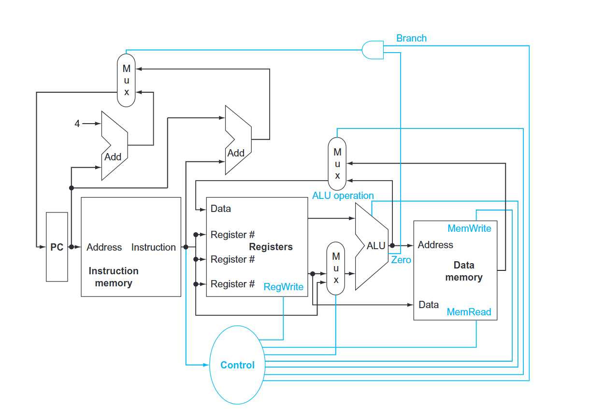
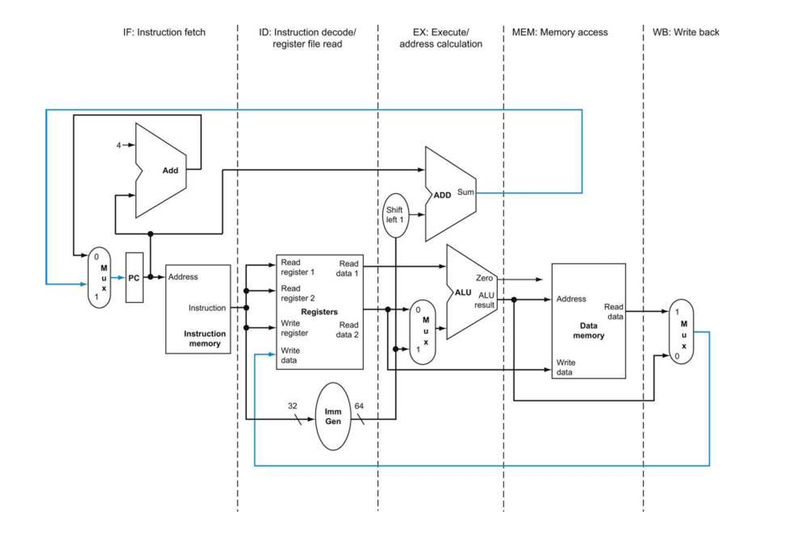

## D8 支持RV32E的NPC

### 准备工作
1. 重构idu.v逻辑
2. 配置cpu-test CI 

### 为NPC搭建sdb

#### 重构NPC仿真流程

将原来集中在 `main.cpp` 的初始化、时钟驱动和运行循环拆开，借鉴 NEMU 的命令层与执行控制结构。

**执行链路**

```text
main()
├── init_monitor(argc, argv)
│   ├── parse_args() → 镜像路径、批处理选项
│   ├── pmem_load() / flash_load()
│   ├── sim_init() → 创建 contextp、top，按配置初始化波形等
│   └── sim_reset() → 复位后进入 STOP
├── sdb_mainloop()
│   ├── 交互：si / c → npc_exec(n)
│   ├── 批处理：直接 c → npc_exec(UINT64_MAX)
│   └── npc_exec → execute → exec_once → single_cycle → RTL / DPI
├── npc_statistics()
└── sim_cleanup() → 返回进程退出码
```

**对比NEMU和NPC**

| 对比 | NEMU | NPC |
|---|---|---|
| 指令语义 | C 代码完成译码、计算和状态更新 | RTL 电路完成 |
| 执行推进 | 调用指令解释函数 | C++ 驱动时钟并eval模型 |
| 一步的完成条件 | exec_once() 完成解释执行 | 观察到指令提交 |
| GPR、PC 的存放位置 | CPU_state cpu | RTL 寄存器 |
| 调试信息来源 | 软件直接取得 | 通过 DPI 等接口从 RTL 导出 |

**Q:** NEMU 和 NPC 中 exec_once()的不同语义
**A:** NEMU 中表示执行一条指令，而NPC中表示推进周期直到提交一条指令

#### NPC实现单步执行
- 验收：
`make run NPC_ARGS="" IMG=/home/cddaaaa/Projects/ysyx/ysyx-workbench-cddaaaa/am-kernels/tests/cpu-tests/build/dummy-minirv-npc.bin ARCH=minirv-npc`

#### 打印寄存器

**方法一** （未采用）
DPI-C 函数：
- RTL侧提供读取函数， 用`export "DPI-C"`导出
- C++侧包含生成的DPI头文件，使用RTL提供的读取函数
- 调用前需要设置 scope，指定读取哪一个寄存器堆实例

SDB → sim_read_gpr() → 设置 scope → RTL 读取函数 → rf

**方法二**
通过verilator 编译出的c++ 文件来访问通用寄存器

```c
static const auto &gpr_file() {   
  return top->rootp->npc_top__DOT__npc__DOT__u_gpr__DOT__rf;
}
```

#### 添加trace

**iringbuf**
| 情况 | NEMU | NPC |
|---|---|---|
| DiffTest 失败 | dump | dump |
| 未识别指令 | 设置 NEMU_ABORT 后 dump | 当前没有对应的统一路径 |
| 周期上限、仿真器提前结束 | 没有 NPC 这类周期检查 | 设置 NPC_ABORT 后 dump |
| 自定义 Assert() 失败 | 通过 assert_fail_msg() dump | 未接入 |

```cpp
if (exec_once()) {
  itrace(...);       
  difftest_step(...);
}
if (npc_state.state == NPC_ABORT) iringbuf_dump(); 
// NPC 特别要要将dump 放到if（exec_once()）外, exec_once可能在没有新提交是因周期上线返回false, iringbuf 需要捕捉这种情况 
```

**mtrace**

在pmem_read和pmem_write中打印访存地址和数据，config.mk中控制开关
目前会同时打印取指和访存；如有需要可以通过将pmem_read分成pmem_read_inst, pmem_read_data 来识别取指指令，并不打印

**ftrace**
*待实现*

#### 为NPC添加表达式求值
整体照搬nemu的实现，适配reg_str2val, nemu 直接读cpu.gpr[i], npc 中有对应的cpu_state.gpr 但其更新在difftes绑定，所以reg_str2val直接读... 

#### 为NPC添加监视点


### 为NPC添加DiffTest支持

**初始化+memcpy复制镜像**

nemu/
├── .config                  切换共享库目标
└── src/cpu/difftest/ref.c    实现内存复制接口

npc/
├── Makefile                 加入源码、链接 -ldl
└── csrc/
    ├── include/difftest.h   声明接口和复制方向
    ├── include/pmem.h      声明地址转换函数
    ├── pmem.cpp            实现 guest_to_host()
    ├── monitor/monitor.cpp 解析 --diff、传递镜像长度
    └── difftest/dut.cpp
        └── 加载 NEMU → 获取接口 → 初始化 → 复制镜像

```c
// nemu/src/cpu/
__EXPORT void difftest_memcpy(paddr_t addr, void *buf, size_t n, bool direction) {
  // addr: NEMU 应写入的目标 guest 物理地址
  // buf: 指向 NPC 待复制数据的 host 指针
  if (direction == DIFFTEST_TO_REF) {    // 从NPC拷贝到NEMU 
    memcpy(guest_to_host(addr), buf, n);      
  } else {
    assert(0);
  }
}
``` 
**Q:** Guest地址与Host地址
**A:** Guest: 被模拟处理器使用的地址，例如 NPC/NEMU 中的物理地址 0x80000000; Host: 仿真程序访问数据的指针，例如pmem 数组的指针

**Q:** npc/dut.cpp 如何使用nemu/ref.cpp中定义的函数， difftest_memcpy，difftest_init, difftest_regcpy
**A:** 
这里使用的是动态加载共享库+函数指针调用的机制
- `dlsym(handle, "difftest_init")` : 从共享库中找到符号的地址
- `(void (*)(int))`: 转为函数指针
- `void (*ref_difftest_init)(int)`: 定义函数指针，用来保存找到的地址

**difftest_regcpy寄存器**
```
nemu/src/cpu/difftest/ref.c
└── 实现 difftest_regcpy()
    ├── TO_REF：传入状态 → NEMU 的 cpu
    └── TO_DUT：NEMU 的 cpu → 传出缓冲区

npc/csrc/
├── include/reg.h
│   └── 定义 CPUState：32 个 GPR + PC，声明 cpu_state
├── reg.cpp
│   └── 定义 cpu_state 变量
├── monitor/monitor.cpp
│   └── 将仿真初始化、复位放到 DiffTest 初始化之前
└── difftest/dut.cpp
    ├── 定义函数指针，通过 dlsym() 获取 regcpy 接口
    ├── 读取 NPC 的 GPR、PC，填入 cpu_state
    └── 调用 regcpy(&cpu_state, DIFFTEST_TO_REF)
```

```c 
__EXPORT void difftest_regcpy(void *dut, bool direction) {
  CPU_state *dut_state = (CPU_state *)dut;  // 转换指针类型，前提是双方约定的struct 布局一致
  if (direction == DIFFTEST_TO_REF) {       // NPC 状态写入 NEMU, 用于初始化
    for(int i=0; i<32; i++) {
      cpu.gpr[i] = dut_state->gpr[i];
    }
    cpu.pc = dut_state->pc;
  } else {                                  // NEMU状态写入NPC
    for(int i=0; i<32; i++) { 
      dut_state->gpr[i] = cpu.gpr[i];
    }  
    dut_state->pc = cpu.pc;
  }
}
```

**difftest_step**

```c
void difftest_step(vaddr_t pc, vaddr_t npc) {
  CPUState ref_r;
  //TODO: skip_dut_nr_instr
  //TODO: is_skip_ref

  for (int i = 0; i < 32; i++) {
    sim_read_gpr(i, cpu_state.gpr[i]);
  }
  cpu_state.pc = npc;

  ref_difftest_exec(1);
  ref_difftest_regcpy(&ref_r, DIFFTEST_TO_DUT);
  checkregs(&ref_r, pc);
}
```

**问题**：跑dummy 镜像时访存越界报错
**解决**：
1. 注释 difftest_step() 后能运行， 说明问题出现在REF部分
2. 用nemu跑dummy 没问题，说明问题出在NPC的镜像
3. 分析报错地址：0x10000003， 属于UART 控制寄存器
4. 查看 AM启动代码， _trm_init() 在 main() 前调用 uart_init()
5. 解决方案，注释掉uart_init(), 在后面的阶段在考虑适配uart


**测试**
- 在RTL中注入错误, 立即数生成大1，difftest 成功捕捉错误

- `make -C am-kernels/tests/cpu-tests ARCH=minirv-npc run DIFFTEST=0` 开启difftest,cpu-test符合预期

**问题** 切换 DIFFTEST=0/1 后，Make 未感知命令行配置变化，继续复用旧仿真程序，导致编译宏与运行参数不一致并触发 DiffTest 断言
**解决** 添加config.mk 作为make sim 依赖， 后续改进是增加stamp文件记录上一次实际使用的配置，这样可以同时使用命令行和config.mk配置


### 搭建riscv32e-npc的AM

**为riscv32e-npc提供run目标**
am-kernels/tests/cpu-tests/Makefile
│
└─ 启动子 Make：
   make -s -f Makefile.dummy ARCH=riscv32e-npc run
   │
   └─ 读取 Makefile.dummy，内容等价于：
      NAME = dummy
      SRCS = tests/dummy.c
      include $(AM_HOME)/Makefile
      │
      └─ 读取 abstract-machine/Makefile
         │
         └─ 根据 ARCH 引入平台配置：
            -include $(AM_HOME)/scripts/$(ARCH).mk
            │
            └─ ARCH=riscv32e-npc，展开为：
               abstract-machine/scripts/riscv32e-npc.mk
               │
               ├─ include $(AM_HOME)/scripts/isa/riscv.mk
               │  配置 RISC-V 工具链和通用编译选项
               │
               └─ include $(AM_HOME)/scripts/platform/npc.mk
                  提供 NPC 平台源码列表、镜像生成和 run 规则

同时npc/Makefile中ARCH=riscv32e-npc 和minirv-npc 共享同一份配置

**实现riscv32e-npc中的halt()函数**
```c
void halt(int code) {
  asm volatile("mv a0, %0; ebreak" : :"r"(code));
  while (1);
}
```
**验收-cputest**
- ARCH=minirv-npc, 除wrong.c ALL PASS 
- ARCH=riscv32e-npc, 因npc不支持auipc指令difftest报错，符合预期

### RV32E 架构图




### 支持RV32E指令

**Branch** 
Branch 指令需要完成两项计算：分支条件比较和目标地址计算。原先 JALR 使用主 ALU 计算目标地址，但单个双输入 ALU 无法在同一周期同时完成这两项计算。因此，在 exu.v 中增加独立加法器，计算 JUMP 和 Branch 的目标地址，主 ALU 则负责分支条件比较。

**difftest也会误导**
```bash
0x800000b8: 00 f1 10 23 sh      a5, 0(sp)   # 实际原因是sh还没实现，但difftest不检查内存， 所以没报错
0x800000bc: f6 df f0 ef jal     -0x94
0x80000028: 40 35 d7 93 srai    a5, a1, 3
0x8000002c: 00 f5 05 33 add     a0, a0, a5
0x80000030: 00 05 45 03 lbu     a0, 0(a0)   # difftest报错位置
```

**Q: 硬件如何区分有符号数和无符号数?**
```c
#include <stdint.h>
int32_t fun1(int32_t a, int32_t b) { return a < b; }
uint32_t fun2(uint32_t a, uint32_t b) { return a < b; }
```
```
00000000 <fun1>:
   0:   00b52533                slt     a0,a0,a1
   4:   00008067                ret

00000008 <fun2>:
   8:   00b53533                sltu    a0,a0,a1
   c:   00008067                ret
```
寄存器的二进制数据本身没有有符号或无符号的标签。当运算确实需要区分时，由编译器选择对应的指令，硬件再根据指令决定如何解释这些位。如果传入a = 0xffffffff，b = 0x00000001。 fun1 有符号， a看成-1，-1<1成立所以返回1； fun2 无符号， a看成4294967295， 4294967295 < 1不成立，返回0。

**Q:RV32E不包含乘除指令, NPC如何正确运行包含乘除法操作的C程序?**
`abstract-machine/scripts/riscv32e-npc.mk` 定义了编译配置，`-march=rv32e_zics` 指定编译生成的代码可以使用rv32e + csr的指令集,  `-mabi=ilp32e` ABI,规定函数参数、返回值怎么传，哪些寄存器需要保存。 

**测试**
- `make -C am-kernels/tests/cpu-tests ARCH=riscv32e-npc run` 除开 wrong  ALL pass
- `make -C riscv-tests ARCH=riscv32e-npc TEST_ISA=i run` ALL PASS
- `make -C riscv-arch-test ARCH=riscv32e-npc TEST_ISA=E run` ALL PASS 
- `make -C am-kernels/benchmarks/microbench ARCH=riscv32e-npc mainargs=test run` ，MicroBench 的 printf() 会访问 UART 寄存器，而 NEMU 参考模型暂未支持对应地址，导致访问越界。同时NEMU也暂时不支持csr. 解决：关闭 DiffTest 并补齐 stdio.c 中的 printf() 后，NPC 独立仿真通过 MicroBench test 规模的全部测试。NEMU的UART 留到C2完成。 

**riscv-arch-test：minirv-npc 栈访问越界**

- 执行 `make -C riscv-arch-test ARCH=minirv-npc TEST_ISA=E run ALL=add-01`，在 PC `0x800000f0` 访问地址 `0x01fddb79`，超出 pmem 范围 `[0x80000000, 0x87ffffff]`。
- 通过反汇编定位到 `sw s0,-4(sp)`；实现 watchpoint 监视 `$sp`，找到前一次修改来自 `0x800000ec` 的 `add sp,gp,tp`。
- 该 `add` 是原始指令 `srli sp,ra,7` 经 minirv 展开后的最后一步。测试初始化中的原始指令为：

  ```asm
  srli sp, ra, 7
  srli a5, ra, 25
  ```

- 第一条右移将 sp 写为测试数据 `0x01fddb7d`；第二条右移的 minirv 展开代码通过 `sw s0,-4(sp)` 保存临时寄存器，因而访问非法地址 `0x01fddb79`。
- 根因是软件适配冲突：架构测试将 x2（sp）当作普通寄存器初始化，而 minirv 替换代码依赖有效的栈指针。这次越界不属于硬件计算错误。

### 按五级数据通路整理了模块职责


Computer Organization and Design by David A. Patterson

- IFU 负责保存 PC、计算 PC + 4 和选择 next_pc
- EXU 负责判断是否跳转并计算目标地址
- WBU 负责选择写回数据

- 用 MuxKey 统一了 alu_src1、alu_src2、rt_src1、wb_data_o 和 next_pc 五处选择逻辑，便于对照架构图阅读 RTL
- 将 x0 写保护移入 GPR

### TODO
1. lsu_misalign 向仿真环境报错
2. 